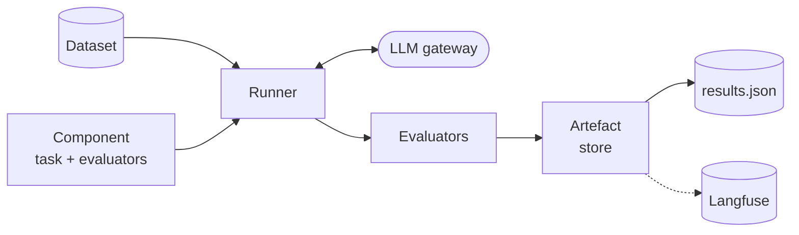

# ThemeFinder evaluation framework

LLM evals for each ThemeFinder stage. Each eval runs the real pipeline code on a dataset, scores the output using a mixture of deterministic and LLM-as-a-judge based metrics, and saves the results locally and, optionally, to Langfuse.

Components: `mapping`, `generation`, `find_themes`, `condensation`, `refinement`.

## How it fits together



| Piece | Where | Why it exists |
|---|---|---|
| Components | `components/` | One file per stage: the task to run and its evaluators |
| Evaluators | `adapters/evaluators/` | One class per metric group |
| Datasets | `data/`, `datasets.py` | Inputs (and reference outputs) per consultation sample |
| Runners | `adapters/runners/` | Swappable execution runners |
| Artefact Stores | `adapters/artefact_stores/` | Swappable result storage |
| Settings | `settings.py`, `params.yaml` | Env vars and the DVC run configuration |
| CI gate | `ci/` | Compares scores to committed baselines |

## Setup

Set these in `.env` (see `settings.py` for the full list):

- `LLM_GATEWAY_URL`, `CONSULT_EVAL_LITELLM_API_KEY`: LLM access
- `LANGFUSE_SECRET_KEY`, `LANGFUSE_PUBLIC_KEY`, `LANGFUSE_BASE_URL`: only needed for Langfuse
- `THEMEFINDER_EVAL_DATASET_SOURCE` / `THEMEFINDER_EVAL_ARTEFACT_STORE`: `local` or `langfuse`

## Running manually

From the repo root:

```bash
make run-evals                      # all components, quick regression test
make run-eval EVAL_TYPE=generation  # one component
```

For evaluating with different datasets or numbers of runs, run from `themefinder/evals/`:

```bash
uv run --extra eval python run_eval.py --component generation --dataset gambling_XS --runs 3
```

- `--runs N` repeats every case to give mean, standard deviation and consistency metrics.
- `--verbose` prints each case's output as well as the scores.
- Results are written to `local_eval_runs/<component>/<dataset>/results.json` and pushed to langfuse if set up in environment variables.

To compare models, pass a model selector to the same command:

```bash
uv run --extra eval python run_eval.py --models <gateway-model> ... --dataset housing_S --runs 3
uv run --extra eval python run_eval.py --family gemini claude   # or --all for every healthy gateway model
```

- Without `--component`, a comparison runs every component.
- `--judge-model` allows you to set the judge model overwriting AUTO_EVAL_JUDGE_MODEL. One judge model will be used to judge all task LLMs for consistency.
- `make run-benchmark` is the full version (`--all`, `housing_S`, 5 runs). Override with `BENCHMARK_DATASET` and `BENCHMARK_RUNS`.
- Results go to `benchmark_results/<id>/`. Run `visualise_benchmark.py --benchmark <id>` for an HTML report.

## Running in CI

Both tiers run on a temporary EC2 runner via `.github/workflows/themefinder-eval-run.yml`, and only when `themefinder/` code or evals change.

| Tier | Trigger | Command | Passes when |
|---|---|---|---|
| Smoke | Pull request | `make eval-smoke` | Every component runs end to end on `gambling_XXS` (scores ignored) |
| Regression | Push to `main`, nightly | `make eval-regression` | Every metric on `gambling_XS` is within tolerance of its baseline for current model |

Regression failures post to Slack. Result files are uploaded as a workflow artefact for 90 days.

Both tiers run through DVC, described below.

## DVC

DVC runs the evals as a reproducible pipeline and records which code, data and settings produced each result.

- `dvc.yaml` defines one `evaluate` stage per component in `params.yaml`. Each stage runs `run_eval.py` and writes `local_eval_runs/<component>/<dataset>/results.json`.
- Stage dependencies are the eval code, `themefinder/src`, the lockfile and the dataset folder. Changing any of them marks the stage as stale.
- `params.yaml` is the run configuration: dataset, number of runs, task model per component, and where datasets and results are read from and written to (`local` or `langfuse`).
- `dvc.lock` records the hashes from the last run.

```bash
cd themefinder/evals
uv run --extra eval dvc repro                 # run stale stages only
uv run --extra eval dvc repro -f              # force every stage
uv run --extra eval dvc exp run -S params.yaml:dataset.name=gambling_XXS   # one-off experiment
uv run --extra eval dvc exp show              # compare experiments
```

Use `-S params.yaml:<key>=<value>` to try a different dataset, model or `runs` count without editing the file. Edit `params.yaml` itself only for a persistent change, such as a new default dataset.

CI uses `dvc repro -f` for regression and `dvc exp run` for smoke runs. Smoke experiments are named `smoke-<commit>`, so they can be told apart from your own experiments.

NOTES:

- DVC can't see changes to a Langfuse dataset. Bump `dataset.revision` in `params.yaml` to force a rerun.
- `dvc exp run` makes a git commit, so it needs a git identity configured.
- Each stage generates responses and evaluates them together, so changing an evaluator prompt also reruns that component's task. Splitting them would avoid this but duplicate the pipeline config. The datasets are small enough that the cost is acceptable.
- `make eval-smoke` and `make eval-regression` modify `params.yaml` and `dvc.lock` in your working tree. Discard those changes afterwards.
- Changing the model in `params.yaml` changes scores. Refresh the baselines if the change is intended.

### Baselines

Baselines live in `baselines/` and hold a score and tolerance per metric. LLM output is noisy, so tolerances come from the spread across repeated runs. To refresh them after an intentional change:

1. Run the evals several times (three is the minimum, five or more gives better tolerances), copying `local_eval_runs/` after each run.
2. `uv run python -m ci.build_baselines --runs <copy1> <copy2> <copy3>`
3. Commit the updated files.

## Adding an evaluation metric

1. Subclass `EvaluatorPort` in `adapters/evaluators/` and set `metric_names`. Implement `_score`, which returns a list of `Score` objects. Errors are caught and recorded as a zero score by the base class.
2. For an LLM-judged metric, put the prompt in `adapters/evaluators/prompts/` and follow an existing judge, such as `clarity_evaluator.py`.
3. Add the evaluator to the relevant `components/<name>.py` config.
4. If lower scores are better, follow the pattern for `RedundancyEvaluator.lower_is_better_metrics`.
5. Try it quickly with `make run-eval EVAL_TYPE=<name>`.
6. **DVC:** no pipeline edits are needed, because `adapters/` and `components/<name>.py` are already stage dependencies. Run `dvc repro` from `themefinder/evals/` to rerun the stale stage, and commit the updated `dvc.lock`.
7. Refresh the baselines (see [baselines](#baselines)). Otherwise the regression check will report a missing metric.

## Adding a component

A component is one ThemeFinder stage to evaluate. Use an existing one, such as `components/refinement.py`, as a template.

1. Create `components/<name>.py` with:
   - a task, `async (inputs, llm) -> dict`, that calls the ThemeFinder stage. For theme outputs, return `build_themes_output(df)` so evaluators get the shape they expect.
   - a `build_<name>_config` function that returns a `ComponentConfig` with the task and its evaluators (see [Adding an evaluation metric](#adding-an-evaluation-metric)).
2. Register it in `components/registry.py`. This adds it to `COMPONENT_NAMES`, which drives the `--component` choices and dataset validation.
3. Add a loader for its cases to `datasets.py` and register it in `load_local_data`. Each case needs `inputs` and, if evaluators compare against a reference, `expected_output`. Add any reference files to the datasets under `data/`.
4. Add tests alongside `tests/test_components.py`.
5. **DVC:**
   - Add the component under `evals:` in `params.yaml` with `model`, `dataset_source` and `artefact_store`. The stage is created from this, so the key must match the component name and the file name in `components/`.
   - Run `dvc repro` and commit `dvc.yaml`/`params.yaml` changes and `dvc.lock`.
6. Build baselines for it (see [baselines](#baselines)). `check_metrics` treats a component without a baseline as invalid, so the regression CI check fails until you do.
7. Run it with `make run-eval EVAL_TYPE=<name>`. Update the `EVAL_TYPE` list in the Makefile help text.

## Adding a dataset

Datasets follow the layout in `data/gambling_XS/` (see its [README](data/gambling_XS/README.md)):

```
data/<name>/
├── inputs/
│   ├── respondents.jsonl
│   └── question_part_N/{question.json, responses.jsonl}
└── outputs/mapping/<date>/question_part_N/   # reference outputs for mapping
```

1. Add the folder under `data/`. Datasets must be synthetic or already public. `SYNTHETIC_DATA_SPEC.md` describes how to generate them, and `generate_synthetic.py` automates it.
2. Run with `--dataset <name>`, or set `dataset.name` in `params.yaml` to change the CI default.
3. To use it from Langfuse, publish it with `uv run python scripts/migrate_to_langfuse.py --dataset <name>`, then set `dataset_source: langfuse` for the relevant evals in `params.yaml`. Existing non-empty Langfuse datasets are not overwritten.
4. **DVC:**
   - `data/<dataset.name>` is a stage dependency, so edits to the selected dataset make every stage stale, and `dvc.lock` records its hash. Other datasets under `data/` are not tracked until selected.
   - Try a new dataset without changing defaults: `dvc exp run -S params.yaml:dataset.name=<name>`.
   - To make it the default, set `dataset.name` in `params.yaml`, run `dvc repro`, and commit `params.yaml` and `dvc.lock`.
   - If it is read from Langfuse, bump `dataset.revision` whenever its contents change.
   - A new default dataset needs its own baselines (see [baselines](#baselines)), as `make eval-regression` checks `gambling_XS`.

If a new component needs a different data shape, add a loader to `datasets.py`.

## Using results in Langfuse

Needs `LANGFUSE_*` set and `THEMEFINDER_EVAL_ARTEFACT_STORE=langfuse`.

- **Scores**: each case's scores are attached to a Langfuse trace. Run-level values (means, standard deviation, consistency) go on one separate trace per run.
- **Filtering**: traces carry a `model:<name>` tag and metadata for model and dataset. Filter on these to compare models, or one model across code versions.
- **Comparing runs**: in Langfuse, open the dataset and select runs to compare their scores side by side.
- **Extracting data for reports**: export the scores or traces table from the Langfuse UI as CSV, or pull them with the Langfuse API or SDK. For the exact numbers behind a run, `local_eval_runs/.../results.json` has the per-case outputs and scores, and `benchmark_results/<id>/` holds the CSVs from model comparisons.

## Tests

```bash
make test-themefinder
```

Evaluator and runner tests are in `tests/`. They don't call a real LLM.
